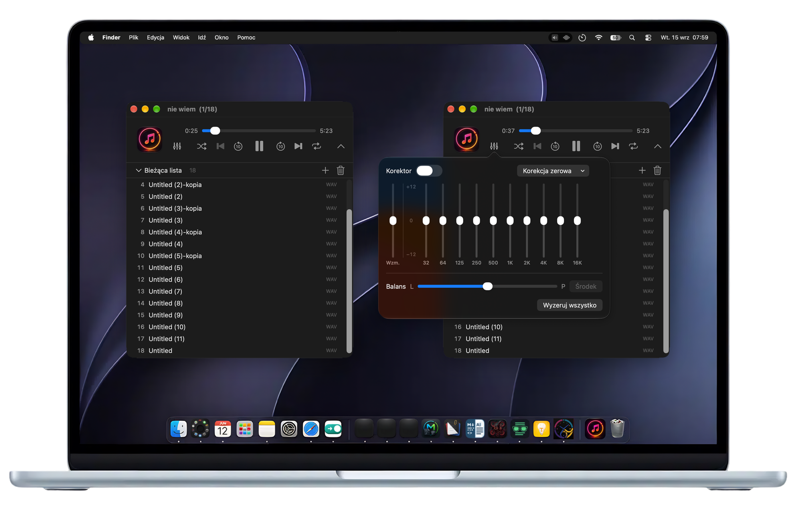

<p align="center">
  
</p>

## MusicLite

**A light, fast music player for macOS. It plays your files and stays out of the way.**

Double-click a song in Finder and it plays in a small window: a position bar, play/pause and ±10 s.
No library to import, no store, no account, no ads, no tracking, no visualisers. A native SwiftUI app
that starts instantly and handles almost any audio format you have, from MP3 to hi-res FLAC and DSD.

[](https://developer.apple.com/xcode/)
[](https://www.apple.com/macos)
[](LICENSE)

> The interface is in Polish.

<p align="center">
  
</p>

---

## Supported formats

| Played directly (AVFoundation) | Played through ffmpeg |
|---|---|
| MP3, AAC / M4A, ALAC | Ogg Vorbis (OGG, OGA) |
| WAV, AIFF / AIFC, CAF, AU | WMA, ASF, WMV (sound only) |
| FLAC (hi-res too) | APE (Monkey's Audio), WavPack, TTA, Musepack |
| AC-3, E-AC-3, MP2 | DSD (DSF, DFF), Matroska audio (MKA), AMR |
| Opus | anything else ffmpeg can read |

MusicLite tries AVFoundation first and hands a file to ffmpeg only when macOS cannot play it.
Formats in the right column need [ffmpeg](https://ffmpeg.org) installed (`brew install ffmpeg`; MacPorts'
`/opt/local/bin` works too). MusicLite decodes such a file once to a temporary lossless ALAC file and plays that;
a long file takes a few seconds before it starts, and the window says so. Without ffmpeg, everything in the left
column still plays.

## What it does

- **One file, one song.** Opening a file plays just that file; the rest of its folder stays out.
- **Lists.** Several files, or a folder (⌘O picks folders too), make a list. The list button (⌘L) unfolds it
  under the controls, and the window can be dragged taller to show more of it. Click a row to play it; when a song
  ends, the next one starts. The playing row shows a speaker instead of its number.
- **Shuffle and repeat.** Shuffle plays every song once per round, and "previous" goes back the way it came.
  Repeat cycles off → whole list → one song. Both are kept between launches.
- **Playlists.** Songs dropped on the window, or added with **+** (⇧⌘O), join the list, so one list can collect
  songs from many folders. Right-click a row to move it, remove it or show it in Finder. ⌘S saves the list as a
  playlist: a plain M3U8 file with full paths, opened again from the Playlisty menu or from the name above the list.
  Songs moved or deleted since are skipped, and MusicLite says how many.
- **Equalizer.** Ten bands (32 Hz–16 kHz, ±12 dB), a preamp and left/right balance (⌥⌘E). The presets are the
  ones from Apple's Music app, with the same values.
- **Now Playing.** The song shows in Control Center (title, cover art from the file, position) and answers the media
  keys and headphone buttons: play/pause, next, previous (rewinds first when the song is past 3 s), and seeking.

Keys: Space play/pause, ← → 10 s back/forward, ⌘O open, ⇧⌘O add to the list, ⌘L song list, ⌘S save playlist.

## Default player

MusicLite registers as an owner of every format in the table, so Finder's **Open With** offers it at once.
To make it the app Finder opens for all of them: app menu → *Ustaw MusicLite jako domyślny odtwarzacz muzyki*,
or `MusicLite --set-default` from Terminal. Only formats that MusicLite does not open yet are changed; macOS asks
to confirm each format that already has an app chosen, and a format refused there stays as it was.

## Requirements

- macOS 14 or later.
- ffmpeg, only for the formats in the right column of the table.

## Uninstalling

Move `MusicLite.app` to the Trash, then remove what it leaves behind:

- `~/Library/Preferences/com.mikagosz.MusicLite.plist` — its settings (list shown, shuffle, repeat, equalizer).
- `~/Library/Application Support/MusicLite/` — saved playlists.
- File associations: formats set to MusicLite go back to another app via Finder → Get Info → Open with → Change All.

Temporary files `MusicLite-*` in the user's temporary folder are removed by MusicLite itself, also after it was
killed; after an uninstall, macOS clears them on its own.

## Building

```bash
./build.sh
```

Runs the checks in `Tests/check.sh`, builds the Release configuration, installs to `~/Applications`
(or the folder named in an untracked `.install-dir`) and starts the app. `--no-open` installs without starting it.

## Licence

The **source code** is released under the [MIT licence](LICENSE).

The **artwork is not**: the app icon (`MusicLite/odtwarzacz.icon/`, `docs/assets/musiclite-icon.png`) is
Copyright (c) 2026 mikagosz, all rights reserved, and is excluded from the MIT grant — see [NOTICE](NOTICE).
It ships with the repository so the project builds as it is shipped; if you fork it, replace it with your own.
